  <picture>
    <source media="(prefers-color-scheme: dark)" srcset="assets/hero-dark.svg">
    <source media="(prefers-color-scheme: light)" srcset="assets/hero-light.svg">
    
  </picture>

  
  
  
  

---

## Sobre mim

Estudante de **Análise e Desenvolvimento de Sistemas (ADS, 2026)** com foco em **Backend Python**, **Desenvolvimento Web (React/PWA)**, **Banco de Dados (PostgreSQL/SQL)**, **Automação de Processos** e **Inteligência Artificial Aplicada**.

Construo sistemas completos ponta a ponta — da modelagem relacional e regras de negócio em APIs REST até interfaces responsivas, fluxos automatizados e arquiteturas multiagente.

---

## Projetos em destaque

- **Fluire** · `Privado · Em produção`
  Sistema digital completo para gestão de estúdios de Pilates: alunos, turmas, frequência, histórico, financeiro e notificações automatizadas.
  Stack: `Python` · `Flask` · `JWT` · `React` · `Vite PWA` · `PostgreSQL` · `Supabase` · `n8n`

- **[Agent Company](https://github.com/CaioRen4to/agent-company)** · `Open source · MIT`
  Arquitetura multiagente com 21 especialistas, 8 *Core Skills*, varredura de segurança em 8 pontos e governança *Fail-Closed*.
  Stack: `Python` · `SQLite` · `GitHub Actions` · `GPT` · `Gemini` · `Claude`

---

## Tecnologias e ferramentas

  
  
  
  
  
  

  
  
  
  
  

  
  
  

---

## Estatísticas e atividade no GitHub

  <picture>
    <source media="(prefers-color-scheme: dark)" srcset="assets/stats-dark.svg">
    <source media="(prefers-color-scheme: light)" srcset="assets/stats-light.svg">
    
  </picture>
  &nbsp;
  <picture>
    <source media="(prefers-color-scheme: dark)" srcset="assets/top-langs-dark.svg">
    <source media="(prefers-color-scheme: light)" srcset="assets/top-langs-light.svg">
    
  </picture>

  <picture>
    <source media="(prefers-color-scheme: dark)" srcset="https://streak-stats.demolab.com?user=CaioRen4to&background=0B0F17&border=1E293B&stroke=1E293B&ring=06B6D4&fire=6366F1&currStreakNum=F8FAFC&sideNums=F8FAFC&currStreakLabel=22D3EE&sideLabels=94A3B8&dates=94A3B8">
    <source media="(prefers-color-scheme: light)" srcset="https://streak-stats.demolab.com?user=CaioRen4to&background=F8FAFC&border=CBD5E1&stroke=CBD5E1&ring=0891B2&fire=4F46E5&currStreakNum=0F172A&sideNums=0F172A&currStreakLabel=0E7490&sideLabels=475569&dates=475569">
    
  </picture>

---

  <em>Sempre aprendendo. Sempre construindo. Sempre evoluindo.</em>

