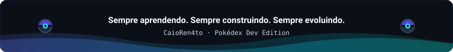

  <a href="https://caioren4to.github.io/" target="_blank" rel="noopener noreferrer" title="Abrir a Pokédex Dev, portfólio interativo de Caio Renato">
    <picture>
      <source media="(prefers-color-scheme: dark)" srcset="assets/hero-dark.svg">
      <source media="(prefers-color-scheme: light)" srcset="assets/hero-light.svg">
      
    </picture>
  </a>

  <picture>
    <source media="(prefers-color-scheme: dark)" srcset="https://readme-typing-svg.demolab.com?font=JetBrains+Mono&weight=600&size=19&duration=2600&pause=1300&repeat=true&center=true&vCenter=true&width=680&height=38&lines=Backend+Python+%26+Flask+%7C+APIs+REST+%26+JWT;React+%26+Vite+PWA+%7C+Interfaces+Responsivas;PostgreSQL+%26+Dados+%7C+Automa%C3%A7%C3%B5es+n8n;Sistemas+Multiagente+com+IA+Aplicada&color=22D3EE">
    <source media="(prefers-color-scheme: light)" srcset="https://readme-typing-svg.demolab.com?font=JetBrains+Mono&weight=600&size=19&duration=2600&pause=1300&repeat=true&center=true&vCenter=true&width=680&height=38&lines=Backend+Python+%26+Flask+%7C+APIs+REST+%26+JWT;React+%26+Vite+PWA+%7C+Interfaces+Responsivas;PostgreSQL+%26+Dados+%7C+Automa%C3%A7%C3%B5es+n8n;Sistemas+Multiagente+com+IA+Aplicada&color=0E7490">
    
  </picture>

  
   
  Explore a arquitetura do Fluire e experimente a simulação do Agent Company.

  
  
  
  

  

---

## Quem sou eu

Oi, eu sou o **Caio**! Estudo **Análise e Desenvolvimento de Sistemas (ADS, 2026)** e moro em **João Pessoa, Brasil**. Gosto de transformar dados em inteligência, automatizar processos e criar soluções que funcionam de verdade.

- **O que estudo:** Backend Python, Desenvolvimento Web (React/PWA), Banco de Dados (PostgreSQL/SQL), Automação de Processos e Inteligência Artificial Aplicada.
- **O que construo:** sistemas completos ponta a ponta, da modelagem do banco e das regras de negócio em APIs REST até interfaces responsivas, fluxos automatizados e arquiteturas multiagente.
- **Como falar comigo:** pelos botões de contato acima (LinkedIn, e-mail ou Instagram).

  
   
  Meu time Pokémon evolui conforme eu faço commits no GitHub.

---

## Pokédex de Projetos

-  **#001 · Fluire** · `Privado · Em produção`
  Sistema digital completo para gestão de estúdios de Pilates: alunos, turmas, frequência, histórico, financeiro e notificações automatizadas.
  Stack: `Python` · `Flask` · `JWT` · `React` · `Vite PWA` · `PostgreSQL` · `Supabase` · `n8n`

-  **#002 · [Agent Company](https://github.com/CaioRen4to/agent-company)** · `Open source · MIT`
  Arquitetura multiagente com 21 especialistas, 8 *Core Skills*, varredura de segurança em 8 pontos e governança *Fail-Closed*.
  Stack: `Python` · `SQLite` · `GitHub Actions` · `GPT` · `Gemini` · `Claude`

---

## Move Set · Tecnologias e Ferramentas

  
  
  
  
  
  

  
  
  
  
  

  
  
  

---

## Cartão de Treinador & Estatísticas no GitHub

  <picture>
    <source media="(prefers-color-scheme: dark)" srcset="assets/trainer-card-dark.svg">
    <source media="(prefers-color-scheme: light)" srcset="assets/trainer-card-light.svg">
    
  </picture>

  <picture>
    <source media="(prefers-color-scheme: dark)" srcset="assets/stats-dark.svg">
    <source media="(prefers-color-scheme: light)" srcset="assets/stats-light.svg">
    
  </picture>
  &nbsp;
  <picture>
    <source media="(prefers-color-scheme: dark)" srcset="assets/top-langs-dark.svg">
    <source media="(prefers-color-scheme: light)" srcset="assets/top-langs-light.svg">
    
  </picture>

  <picture>
    <source media="(prefers-color-scheme: dark)" srcset="https://streak-stats.demolab.com?user=CaioRen4to&background=0B0F17&border=1E293B&stroke=1E293B&ring=06B6D4&fire=6366F1&currStreakNum=F8FAFC&sideNums=F8FAFC&currStreakLabel=22D3EE&sideLabels=94A3B8&dates=94A3B8">
    <source media="(prefers-color-scheme: light)" srcset="https://streak-stats.demolab.com?user=CaioRen4to&background=F8FAFC&border=CBD5E1&stroke=CBD5E1&ring=0891B2&fire=4F46E5&currStreakNum=0F172A&sideNums=0F172A&currStreakLabel=0E7490&sideLabels=475569&dates=475569">
    
  </picture>

---

## Cobrinha de Contribuições

  <picture>
    <source media="(prefers-color-scheme: dark)" srcset="assets/github-snake-dark.svg">
    <source media="(prefers-color-scheme: light)" srcset="assets/github-snake-light.svg">
    
  </picture>

---

## Frase do Dia

  

  <picture>
    <source media="(prefers-color-scheme: dark)" srcset="assets/footer-dark.svg">
    <source media="(prefers-color-scheme: light)" srcset="assets/footer-light.svg">
    
  </picture>

